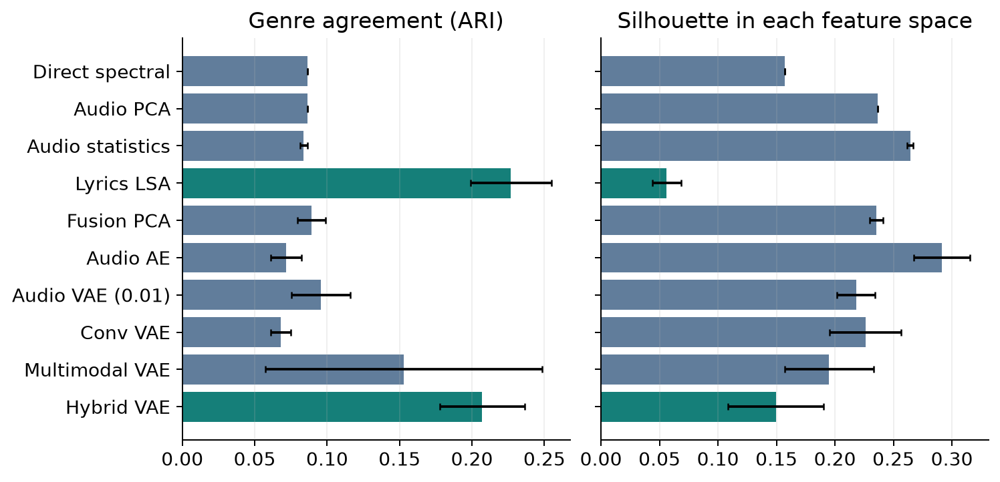
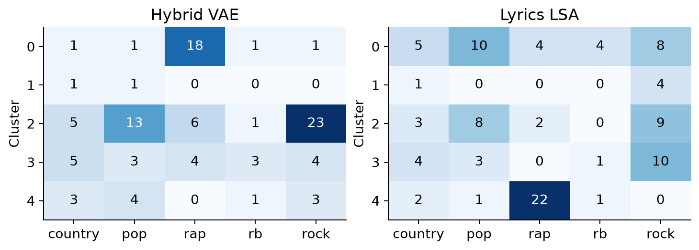
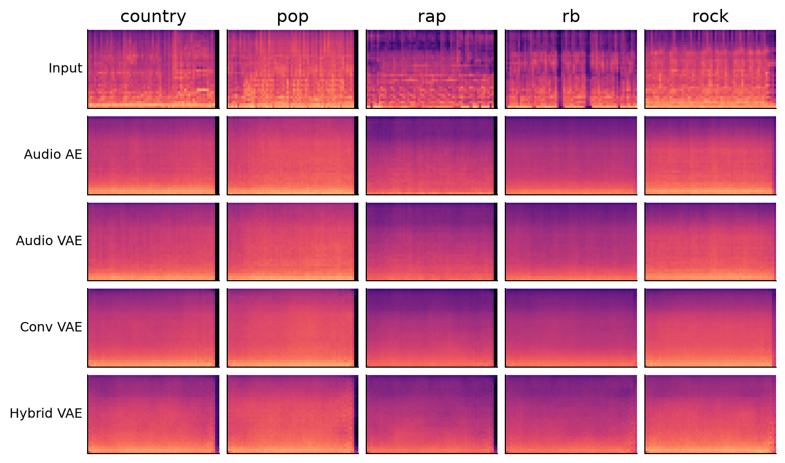
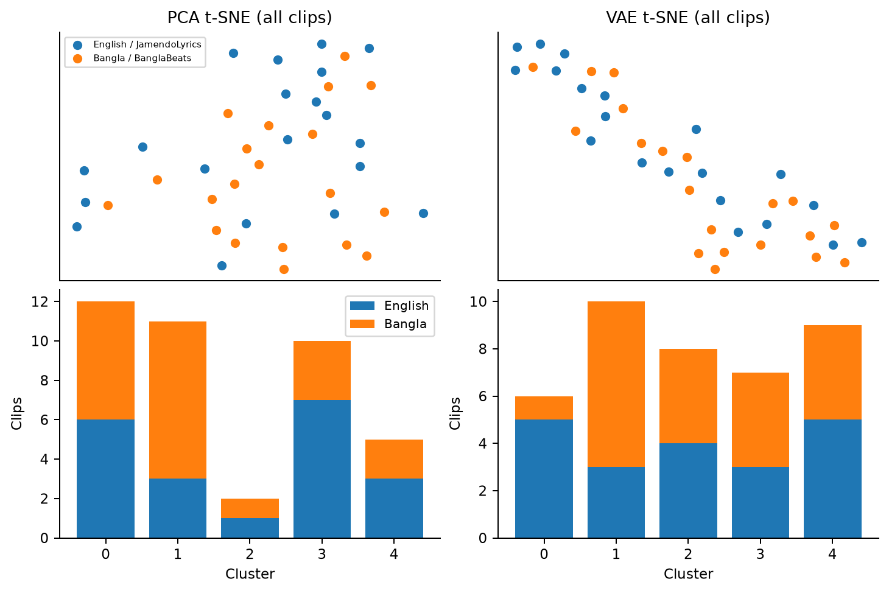

# Multimodal VAE Music Clustering

**SM Azmain Faysal** · Department of Computer Science and Engineering, BRAC University  
Solo course project, CSE425 Neural Networks, Fall 2025 · Supervisor: Moin Mostakim

## Abstract

Can a model recover musical genres by learning to reconstruct a song's audio and lyrics? I investigated this question after finding that a variational autoencoder (VAE) from the original course experiments achieved a silhouette score of 0.894 while placing 679 of 683 songs in one cluster. I rebuilt the evaluation around a held-out question: after learning representations and cluster centers on training songs, how closely do assignments for new songs agree with their genre labels?

On 102 held-out songs, the convolutional audio–lyrics hybrid achieved a mean adjusted Rand index (ARI) of **0.207**, compared with **0.096** for a dense audio VAE and **0.227** for a text-only baseline. Two additional grouped splits produced the same ordering. Lyrics carried substantial genre information in this collection. The experiments support adding lyrics to the audio representation, while the incremental value of audio over lyrics remains uncertain.

[Research report](https://github.com/Tarunno360/Multimodal-VAE-Music-Clustering/blob/main/output/pdf/VAE_Music_Clustering_Report.pdf) · [Saved results](https://github.com/Tarunno360/Multimodal-VAE-Music-Clustering/tree/main/results/analysis)

## From the original experiment to a held-out benchmark

Silhouette measures how close each point lies to its own cluster relative to neighboring clusters. ARI measures agreement between two partitions, adjusted for chance. In the archived beta-VAE experiment, four singleton clusters and one cluster containing 679 songs gave an ARI of −0.001. The conditional VAE showed a similar pattern: a silhouette of 0.954 and an ARI near zero. Both are in-sample measurements. The saved posterior means show little dispersion, but the archive lacks the posterior variances needed for a full diagnosis of posterior collapse.

My contribution was to trace those scores to the underlying assignments, align the song IDs across modalities, and design controls for three possible explanations of the results: acoustic structure, lexical information, and the pairing between a recording and its lyrics.

## Data and experimental design

| | Main audio–lyrics study | English–Bangla feasibility study |
|---|---|---|
| Observations | 683 processed songs matched by ID to 796 metadata rows | 20 English recordings from JamendoLyrics and 20 Bengali clips from BanglaBeats |
| Inputs | Cached 128 × 256 spectrogram and aligned lyrics per song | Three seconds of audio per clip |
| Reference labels | Rock 178, rap 178, pop 153, country 109, R&B 65 | Language, which also identifies collection source |
| Evaluation | Fit on training songs and predict held-out assignments | Fit and describe clusters across all 40 clips |

For the main study, I grouped songs sharing a normalized title, normalized lyrics, or an identical spectrogram. The 676 resulting groups were split without genre stratification into 478 training, 103 validation, and 102 test songs. The test set contains six R&B songs. Grouping reduces duplicate leakage, although missing artist IDs prevent an artist-disjoint evaluation.

**Representation learning.** A fixed 4 × 4 average pool reduces each spectrogram to 32 × 64. Audio normalization uses training statistics. Lyrics are represented by word unigram and bigram TF-IDF features followed by truncated SVD to 64 dimensions and standardization. The text-only baseline projects these features to 32 dimensions with PCA. Vocabulary, projections, and scalers are fitted exclusively on training songs. An archived 384-dimensional lyrics matrix lacks a model revision and row-ID manifest, so the rebuilt experiments derive text features directly from the lyrics.

**Models and optimization.** The dense VAE encodes 2,048 audio values through layers of 256 and 128 units. The convolutional encoder uses three stride-two layers with 8, 16, and 32 channels. The hybrid concatenates the convolutional audio representation with a learned lyric representation and predicts a 32-dimensional Gaussian posterior. Separate decoders reconstruct audio and lyrics using linear outputs for signed targets. Training minimizes mean squared error for each available modality plus a weighted mean KL penalty per latent dimension. I used Adam at 0.001, batches of 64, a 20-epoch KL warmup, and a maximum of 100 epochs. The validation objective determined checkpoint selection.

**Clustering.** K-means fits training representations using 20 initializations and assigns each test song to a learned center. The primary comparison fixes five clusters from the known genre count. Genre labels are used to score the unsupervised models. Additional analyses vary the cluster count and examine Ward clustering and DBSCAN fitted directly on test embeddings. Those two analyses describe structure within the test set. DBSCAN scores exclude noise and are accompanied by coverage.

## Results

The primary metric is held-out genre ARI. The table reports means over five seeds (11, 22, 33, 44, 55), with sample standard deviations for ARI. Purity is the proportion of songs assigned their cluster's majority genre. Assigning every test song the most common genre would yield purity 0.304.

| Representation | ARI, mean ± SD | NMI | Silhouette | Purity |
|---|---:|---:|---:|---:|
| Direct spectrogram features | 0.086 ± 0.000 | 0.128 | 0.157 | 0.441 |
| Audio PCA | 0.086 ± 0.000 | 0.128 | 0.236 | 0.441 |
| Audio temporal statistics | 0.084 ± 0.003 | 0.121 | 0.264 | 0.449 |
| Lyrics only (LSA) | **0.227 ± 0.028** | **0.258** | 0.056 | **0.541** |
| Audio + lyrics, fusion PCA | 0.089 ± 0.010 | 0.119 | 0.236 | 0.447 |
| Audio autoencoder | 0.072 ± 0.010 | 0.119 | 0.292 | 0.422 |
| Dense audio VAE, β = 0.01 | 0.096 ± 0.020 | 0.128 | 0.218 | 0.449 |
| Convolutional audio VAE | 0.068 ± 0.007 | 0.103 | 0.226 | 0.418 |
| Dense audio–lyrics VAE | 0.153 ± 0.096 | 0.177 | 0.195 | 0.467 |
| Convolutional audio–lyrics hybrid | **0.207 ± 0.029** | 0.241 | 0.149 | 0.516 |



*Figure 1. Text-only LSA has the highest mean genre agreement and the lowest silhouette in this comparison. Each silhouette is measured in the representation's own feature space. The figure's historical “Direct spectral” label denotes K-means on flattened pooled spectrograms.*

The hybrid's paired ARI difference from the dense audio VAE was +0.111, with an exploratory 95% bootstrap interval of [0.030, 0.195]. Against text alone, the difference was −0.020 [−0.126, 0.092]. The intervals resample test duplicate groups and seeds 1,000 times with the fitted models held fixed.



*Figure 2. For seed 11, the hybrid's cluster 0 contains 18 rap songs among 22 tracks. The text model's cluster 4 contains 22 rap songs among 26 tracks. Other clusters mix genres. Cluster numbers are arbitrary within each model.*

### Sensitivity to the split

| Mean test ARI | Primary split (2026) | Follow-up (2027) | Follow-up (2028) |
|---|---:|---:|---:|
| Dense audio VAE | 0.096 | 0.102 | 0.044 |
| Convolutional hybrid | 0.207 | 0.192 | 0.183 |
| Lyrics only | 0.227 | 0.277 | 0.272 |

The column labels are random seeds. The two follow-up evaluations used unchanged hyperparameters after inspection of the primary results. All three splits draw from the same corpus.

### What the controls reveal

- **Pairing.** Independently shuffling lyrics within each split reduced dense multimodal ARI from 0.153 to 0.032. This control breaks both track correspondence and the association of the assigned lyrics with the track's genre. It cannot isolate fine-grained audio–lyric alignment from genre-level lexical cues.
- **Regularization.** Increasing the audio VAE's β from 0.01 to 1 raised silhouette from 0.218 to 0.435 while ARI fell from 0.096 to 0.067. Mean training active units fell from 32 to 18.6. A free-bits threshold of 0.05 improved dense multimodal ARI by 0.019, with a paired interval spanning zero.
- **Conditioning.** The audio and multimodal conditional VAEs receive true genre at inference. Their ARIs (0.067 and 0.164) are reported separately because they answer a different question.



*Figure 3. Each column uses the first test example of one genre. The common color scale shows how the models preserve broad spectral structure while smoothing finer detail. The convolutional audio VAE had lower test audio reconstruction error than the hybrid (0.157 versus 0.194 MSE), despite lower genre agreement.*

## English–Bangla audio experiment

I used three-second English excerpts beginning at the first annotated lyric line and released three-second Bengali clips sampled across eight genre folders. Both sources were converted to mono at 22,050 Hz and processed with 128 mel bins, a 2,048-sample FFT, a 512-sample hop, and per-clip relative dB scaling. PCA and an eight-dimensional audio VAE used 32 clips for fitting and eight for validation. K-means then fitted and scored all 40 representations.

| Five-cluster result | Silhouette | Calinski–Harabasz | Language ARI |
|---|---:|---:|---:|
| PCA | 0.175 ± 0.026 | 10.025 ± 0.222 | 0.003 ± 0.010 |
| Audio VAE | 0.376 ± 0.023 | 54.907 ± 5.140 | −0.005 ± 0.011 |



*Figure 4. The lower panels count clips from each source in the five seed-11 clusters. Every English clip came from JamendoLyrics and every Bengali clip from BanglaBeats. The experiment demonstrates that the pipeline processes both collections. Language, recording source, and excerpt selection cannot be separated in this design.*

## Scope and limitations

The main results are reproducible from the supplied feature arrays. The original waveforms and extraction recipe are unavailable, and the reported GTZAN attribution lacks a track-level mapping. The main corpus has no verified language labels. The Bengali release lacks paired lyrics and original song IDs. Data reuse rights also remain unresolved. These constraints limit conclusions about new artists, other collections, and multilingual genre discovery.

Genre agreement measures one aspect of musical similarity. The reconstructions, interpolations, and t-SNE plots provide descriptive evidence. Perceptual quality would require listening evaluation. An independent corpus with documented extraction, artist-disjoint partitions, and pretrained audio and text baselines would allow a stronger test of whether audio adds information beyond lyrics.

## Reproducing the study

The repository contains the frozen configuration, input hashes, saved splits, per-seed metrics, training histories, and a locked environment. The original runs used Python 3.12 and CPU PyTorch on an Apple M1. From the repository root:

```bash
python3.12 -m venv .venv
source .venv/bin/activate
python -m pip install -r requirements-lock.txt
python scripts/import_legacy_inputs.py
python -m pytest -q
python -m musicvae.experiment --config configs/smoke.json --output results/my_smoke
python -m musicvae.experiment --config configs/main.json --output results/my_replication
```

The smoke configuration checks execution. The main configuration runs the primary study. Use a new output directory for each fresh run. A fresh clone includes published measurements and histories. Reloading trained checkpoints or reconstructing individual assignments requires regenerating the fitted artifacts. Across the primary study, extension, bilingual experiment, and two follow-up splits, the archived runs cover 125 neural models and 2,980 evaluation records.

| Where to look | Contents |
|---|---|
| `musicvae/`, `configs/`, `tests/` | ID alignment, preprocessing, model architectures, training, evaluation, and tests |
| `dataset/`, `data/bilingual/`, `DATA_CARD.md` | Cached primary inputs, bilingual acquisition manifest, and provenance |
| `results/rebuilt_v1/`, `results/requirements_extension/` | Primary study, direct spectrogram baseline, and multimodal genre oracle |
| `results/analysis/`, `results/robustness_2027/`, `results/robustness_2028/` | Aggregates, bootstrap contrasts, seed stability, and split sensitivity |
| `scripts/`, `results/bilingual/` | Data acquisition, additional experiments, bilingual assignments, and metrics |
| `audit/`, `model and tasks/`, `notebooks/` | Historical findings, original notebooks, and executed project walkthrough |
| `output/pdf/` | Named report and anonymous research draft |
